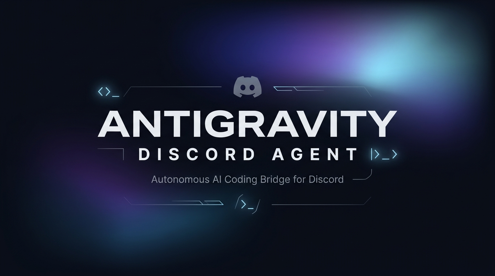

<p align="center">
  
</p>

<p align="center">
  <strong>Bridge bot Discord untuk Google Antigravity CLI di komputer lokal.</strong><br>
  Kendalikan coding agent, eksekusi tugas, inspeksi proyek, dan pantau sistem langsung dari chat Discord.
</p>

<p align="center">
  
  
  
  
  
</p>

---

## Fitur Utama

- **Kontrol AI Jarak Jauh**: Chat langsung dengan Antigravity CLI agent via channel atau thread Discord tanpa perlu membuka laptop.
- **Continuous Learning dari Video (`/enhance`)**: Ekstrak tips koding, arsitektur, dan best practice langsung dari link video **TikTok** atau **Instagram Reels**, lalu terapkan ke system prompt secara **Global** atau **Per-Channel**.
- **Multi-Account Manager (`/account`)**: Simpan dan beralih antar beberapa profil akun Google Gemini Pro dengan 1-klik di Discord tanpa batasan kuota.
- **In-Bot Auto-Update (`/update` & `/broadcast-update`)**: Pantau pembaruan kode GitHub secara real-time dan perbarui bot di laptop hanya dengan menekan tombol `[🚀 Pull & Update Sekarang]`.
- **Channel-to-Directory Mapping**: Otomatis memetakan nama channel Discord ke folder kerja proyek tertentu di laptop (contoh: `#web-app` otomatis membuka direktori proyek web).
- **Two-Way File Attachment**:
  - Kirim berkas di Discord dan bot otomatis menyimpannya ke folder kerja lokal laptop.
  - Minta AI mengirim berkas, lalu bot otomatis mengunggah dokumen/hasil kodingan sebagai lampiran Discord.
- **Directory Tree Viewer (`/tree`)**: Visualisasi hierarki direktori proyek secara instan dengan filter otomatis folder bising (`node_modules`, `.git`, `.next`, `dist`, lockfiles).
- **Voice Channel Assistant (`/join`, `/say`)**: Notifikasi suara hands-free berbasis TTS bahasa Indonesia saat tugas selesai atau saat server crash.
- **Web Preview Tunnel (`/preview`)**: Buka akses publik instan via Cloudflare Tunnel untuk menguji aplikasi web lokal dari smartphone.
- **Server Crash Watchdog (`/watch-server`)**: Memantau dev server secara real-time dan menyediakan tombol 1-Click AI Fix untuk diagnosis bug otomatis.
- **Interactive Git & Terminal**: Akses perintah PowerShell cepat (`/exec`) serta kontrol Git terpadu (`/git` status, diff, commit, push, pull).
- **Remote Workstation Control**: Pantau performa hardware laptop (`/status`), ambil tangkapan layar live (`/screen`), serta kontrol daya (`/lock`, `/sleep`, `/shutdown`).

---

## Prasyarat

Sebelum memulai instalasi, pastikan sistem kamu memenuhi kebutuhan berikut:

1. **Node.js** versi 18 atau lebih baru ([Unduh Node.js](https://nodejs.org/)).
2. **Google Antigravity CLI (`agy`)** sudah terpasang dan dapat dijalankan dari terminal.
3. **Akun & Aplikasi Discord**:
   - Buat aplikasi baru melalui [Discord Developer Portal](https://discord.com/developers/applications).
   - Di menu **Bot**, salin dan simpan **Bot Token**.
   - Di menu **OAuth2** > **URL Generator**, pilih scope `bot` dan `applications.commands` dengan izin pesan, berkas, dan embed.

> **Penting (Privileged Gateway Intents):**  
> Pada tab **Bot** di Discord Developer Portal, pastikan ketiga izin berikut diaktifkan:
> - `Presence Intent`
> - `Server Members Intent`
> - `Message Content Intent` (Wajib aktif agar bot dapat membaca perintah obrolan)

---

## Panduan Instalasi

### 1. Clone Repository

```bash
git clone https://github.com/willgregorry/discord-antigravity-agent.git
cd discord-antigravity-agent
```

### 2. Jalankan Setup Wizard

Jalankan wizard otomatis untuk menginstal dependensi dan mengonfigurasi kredensial:

**Di Windows:**
Cukup jalankan file batch:
```cmd
scripts\setup.bat
```

**Atau via Terminal:**
```bash
npm install
npm run setup
```

Wizard akan memandu pengisian:
- `DISCORD_BOT_TOKEN`: Token bot Discord kamu.
- `ALLOWED_USER_IDS`: Discord User ID kamu (opsional, membatasi agar hanya kamu yang dapat memberi perintah).
- `DEFAULT_DIR`: Direktori kerja utama di laptop kamu.

### 3. Pemetaan Direktori (`config.json`)

Sesuaikan file `config.json` untuk menghubungkan nama channel Discord ke folder proyek lokal:

```json
{
  "default_model": "gemini-3.8-flash-medium",
  "channel_directories": {
    "general": "C:\\Users\\Username\\Projects",
    "web-app": "C:\\Users\\Username\\Projects\\web-app",
    "skripsi": "D:\\Kuliah\\Skripsi"
  }
}
```

---

## Menjalankan Bot

Gunakan salah satu metode berikut:

```bash
npm start
```

*Di Windows, kamu juga dapat langsung menjalankan `scripts/start.bat` atau menggunakan `scripts/start-hidden.vbs` agar berjalan tanpa jendela terminal terbuka di latar belakang.*

---

## Daftar Perintah

Gunakan perintah `/help` di Discord untuk melihat panduan interaktif lengkap dengan navigasi dropdown. Berikut ringkasan perintah yang tersedia:

| Perintah | Deskripsi |
| :--- | :--- |
| `/help` | Menampilkan panduan interaktif terstruktur per kategori |
| `/enhance <url>` | Pelajari & ekstrak kaidah koding dari video TikTok / Reels |
| `/enhancements` | Kelola skill aktif/nonaktif hasil pembelajaran video |
| `/update` | Periksa dan unduh pembaruan terbaru dari GitHub (git pull) |
| `/broadcast-update` | Siarkan kartu notifikasi update dengan tombol 1-Click Pull |
| `/account` | Menu manajemen & switch profil multi-akun Gemini Pro |
| `/tree` | Menampilkan struktur hierarki folder proyek aktif |
| `/usage` | Cek kuota model Gemini dan waktu reset realtime |
| `/pwd` | Tampilkan direktori kerja dan model AI aktif di channel ini |
| `/cd <path>` | Pindah direktori kerja sesi aktif channel ini |
| `/projects` | Pilih direktori kerja dari menu pilihan favorit |
| `/model` | Ganti model AI yang digunakan (Gemini Flash, Claude Sonnet, dll) |
| `/browse` | File explorer interaktif untuk mengunduh berkas proyek ke HP |
| `/send <path>` | Mengirim berkas dari komputer lokal ke channel Discord |
| `/preview <port>` | Membuka URL publik live via Cloudflare Tunnel |
| `/watch-server <cmd>` | Menjalankan dev server dengan proteksi pemantau crash |
| `/exec <cmd>` | Menjalankan perintah PowerShell di folder kerja |
| `/git` | Menu interaktif kontrol Git (Status, Diff, Commit, Push, Pull) |
| `/status` | Cek status CPU, RAM, disk, baterai, dan uptime laptop |
| `/screen` | Mengambil tangkapan layar live monitor laptop |
| `/join` / `/leave` | Kontrol asisten suara di Discord Voice Channel |
| `/say <text>` | Ucapkan teks menggunakan TTS natural di Voice Channel |
| `/clear` | Reset riwayat percakapan sesi channel ini |
| `/stop` | Batalkan proses AI atau perintah terminal yang sedang berjalan |

---

## Struktur Direktori Proyek

```text
.
├── assets/                   # Aset visual & banner README
│   └── banner.png
├── scripts/                  # Skrip otomasi & launcher sistem (.bat, .vbs)
│   ├── restart.bat
│   ├── setup.bat
│   ├── start.bat
│   ├── start-hidden.vbs
│   └── stop.bat
├── src/                      # Source code aplikasi
│   ├── bot.js                # Discord client & handler interaksi
│   ├── core/                 # Engine penghubung Antigravity CLI
│   │   ├── agent.js
│   │   ├── agy-runner.js
│   │   └── tools.js
│   └── services/             # Modul background services
│       ├── account-service.js
│       ├── enhancement-service.js
│       ├── git-service.js
│       ├── notes-service.js
│       ├── quota-service.js
│       ├── system-service.js
│       ├── tree-service.js
│       ├── tunnel-service.js
│       ├── update-service.js
│       ├── voice-service.js
│       └── watchdog-service.js
├── tests/                    # Pengujian modul
├── config.example.json       # Template konfigurasi channel
├── index.js                  # Entry point aplikasi
├── package.json
├── README.md
└── setup.js                  # CLI setup wizard interaktif
```

---

## Keamanan

- Berkas `.env` menyimpan token sensitif dan sudah dimasukkan ke `.gitignore`. **Jangan pernah mengunggah berkas `.env` ke repository publik.**
- Disarankan mengisi opsi `ALLOWED_USER_IDS` di berkas `.env` bila bot berada di server yang memiliki anggota lain, sehingga hak eksekusi dibatasi hanya untuk pemilik laptop.

---

## Lisensi

Didistribusikan di bawah lisensi [ISC](LICENSE). Bebas digunakan dan dimodifikasi untuk kebutuhan pribadi maupun tim.
