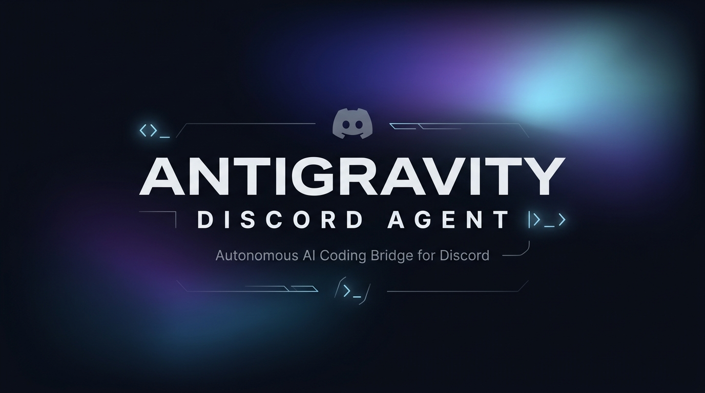

<p align="center">
  
</p>

<p align="center">
  <strong>Bridge bot Discord untuk Google Antigravity CLI di komputer lokal.</strong><br>
  Kendalikan coding agent, eksekusi tugas, inspeksi proyek, dan pantau sistem langsung dari chat Discord dengan arsitektur modular SOLID.
</p>

<p align="center">
  
  
  
  
  
</p>

---

## Fitur Utama

- **Kontrol AI Jarak Jauh**: Chat langsung dengan Antigravity CLI agent (`agy`) via channel atau thread Discord tanpa perlu membuka laptop.
- **Per-Prompt Quota & Token Breakdown**: Otomatis melampirkan kartu YAML ringkas di akhir setiap balasan berisi persentase kuota terpakai, sisa kuota (`5h` & `Weekly`), serta pemisahan **Output Token Baru** vs **Context/Cache Token**.
- **Continuous Learning dari Video (`/enhance`)**: Ekstrak kaidah koding dan best practice langsung dari link **TikTok** atau **Instagram Reels**, lalu terapkan ke system prompt secara **Global** atau **Per-Channel**.
- **Multi-Account Manager (`/account`)**: Simpan dan alihkan beberapa profil akun Google Gemini Pro dengan 1-klik di Discord menggunakan native C# Windows Credential helper (`cred_helper.exe`).
- **In-Bot Auto-Update (`/update` & `/broadcast-update`)**: Pantau pembaruan GitHub secara berkala dan perbarui bot di laptop hanya dengan 1-klik tombol `[🚀 Pull & Update Sekarang]`.
- **Channel-to-Directory Mapping**: Otomatis memetakan nama channel Discord ke folder kerja proyek tertentu di laptop (misal: `#web-app` langsung membuka folder proyek web).
- **Two-Way File Attachment**:
  - Kirim berkas di Discord dan bot otomatis mengunduhnya ke folder kerja sementara per channel.
  - Minta AI mengirim berkas atau gunakan `/send` & `/browse` untuk mengunggah dokumen langsung ke chat Discord.
- **Directory Tree Viewer (`/tree`)**: Visualisasi hierarki direktori proyek dengan filter otomatis (`node_modules`, `.git`, `.next`, `dist`, lockfiles).
- **Voice Channel Assistant (`/join`, `/say`)**: Notifikasi suara hands-free berbasis Microsoft Edge TTS bahasa Indonesia saat tugas selesai atau server crash.
- **Web Preview Tunnel (`/preview`)**: Buka URL publik HTTPS instan via Cloudflare Tunnel untuk menguji aplikasi web lokal dari smartphone.
- **Server Crash Watchdog (`/watch-server`)**: Memantau dev server secara real-time dengan tombol **1-Click AI Fix** saat terjadi crash.
- **Interactive Git & Terminal**: Eksekusi perintah PowerShell (`/exec`) serta kontrol Git terpadu (`/git` status, diff, commit modal, push, pull).
- **Remote Workstation Control**: Pantau CPU/RAM/baterai (`/status`), ambil tangkapan layar live (`/screen`), serta kontrol daya (`/lock`, `/screen-off`, `/sleep`, `/shutdown`).

---

## Prasyarat

1. **Node.js** versi 18 atau lebih baru ([Unduh Node.js](https://nodejs.org/)).
2. **Google Antigravity CLI (`agy`)** sudah terpasang dan login di terminal.
3. **Aplikasi Bot Discord** dari [Discord Developer Portal](https://discord.com/developers/applications) dengan **Bot Token** dan scope `bot` + `applications.commands`.

> **Penting (Privileged Gateway Intents):**  
> Pada tab **Bot** di Discord Developer Portal, aktifkan ketiga intent berikut:
> - `Presence Intent`
> - `Server Members Intent`
> - `Message Content Intent` *(Wajib agar bot dapat membaca obrolan)*

---

## Panduan Instalasi

### 1. Clone Repository

```bash
git clone https://github.com/willgregorry/discord-antigravity-agent.git
cd discord-antigravity-agent
```

### 2. Jalankan Setup Wizard

**Di Windows:**
```cmd
scripts\setup.bat
```

**Atau via Terminal:**
```bash
npm install
npm run setup
```

Konfigurasi `.env` utama yang dibutuhkan (lihat `.env.example` untuk opsi lengkap):
- `DISCORD_TOKEN`: Token bot Discord kamu.
- `ALLOWED_USER_IDS`: Discord User ID pemilik (opsional, membatasi akses bot hanya untuk kamu).
- `DEFAULT_DIR`: Direktori kerja utama default di laptop.

### 3. Pemetaan Direktori (`config.json`)

Salin atau sesuaikan `config.example.json` ke `config.json` untuk menghubungkan nama channel Discord ke folder proyek lokal:

```json
{
  "default_model": "gemini-3.8-flash-medium",
  "channel_directories": {
    "general": "C:\\Users\\Username\\Projects",
    "web-app": "C:\\Users\\Username\\Projects\\web-app",
    "skripsi": "D:\\Kuliah\\Skripsi"
  }
}
```

### 4. Menjalankan & Menguji Bot

```bash
# Jalankan unit test arsitektur & utilitas
npm test

# Jalankan bot
npm start
```

*Di Windows, gunakan `scripts/start.bat` atau `scripts/start-hidden.vbs` untuk menjalankan bot secara silent di background.*

---

## Daftar Perintah

Ketik `/help` di Discord untuk melihat panduan interaktif dengan navigasi dropdown. Ringkasan perintah:

| Perintah | Deskripsi |
| :--- | :--- |
| `/help` | Panduan interaktif terstruktur per kategori |
| `/usage` | Cek sisa kuota model AI dan waktu reset realtime |
| `/account` | Manajemen & switch profil multi-akun Gemini Pro |
| `/enhance <url>` | Ekstrak & terapkan kaidah koding dari video TikTok / Reels |
| `/enhancements` | Kelola skill aktif/nonaktif (Global vs Per-Channel) |
| `/update` | Periksa dan unduh pembaruan terbaru dari GitHub (`git pull`) |
| `/broadcast-update` | Siarkan kartu notifikasi update dengan tombol 1-Click Pull |
| `/tree` | Visualisasi hierarki folder proyek aktif |
| `/browse` | File explorer interaktif untuk menelusuri & mengunduh berkas |
| `/send <path>` | Mengirim berkas dari komputer lokal ke channel Discord |
| `/pwd` / `/cd` / `/projects` | Cek, pindah, atau pilih folder kerja channel dari daftar favorit |
| `/model` | Pilih atau ubah model LLM (Gemini, Claude, Argon, GPT-OSS) |
| `/preview <port>` | Membuka URL publik live via Cloudflare Tunnel |
| `/watch-server <cmd>` | Menjalankan dev server dengan proteksi pemantau crash AI |
| `/exec <cmd>` | Menjalankan perintah PowerShell di folder kerja |
| `/git` | Menu interaktif Git (Status, Diff, Commit, Push, Pull) |
| `/status` / `/screen` | Monitor hardware laptop & tangkapan layar live |
| `/lock` / `/sleep` / `/shutdown` | Kontrol kunci layar, sleep mode, dan remote shutdown |
| `/join` / `/leave` / `/say` | Kontrol asisten suara TTS di Discord Voice Channel |
| `/notes` / `/clear` / `/stop` | Catatan scratchpad per channel, reset obrolan, dan stop task |

---

## Arsitektur Kode (SOLID & Modular)

Repository ini dirancang mengikuti prinsip **SOLID** agar mudah dibaca, diuji, dan dikembangkan oleh kontributor open-source:

```text
.
├── assets/                       # Aset visual & banner README
├── scripts/                      # Skrip otomasi (.bat, .vbs, C# WinCred helper)
├── src/
│   ├── bot.js                    # Orchestrator tipis (DI container & event wiring)
│   ├── commands/                 # Plugin modul perintah (Open/Closed Principle)
│   │   ├── index.js              # Daftar modul aktif (extension point)
│   │   ├── router.js             # Dispatcher terpusat Slash, Prefix (!), Button, Select, Modal
│   │   ├── ai-runner.helper.js   # Unified executor prompt AI & Auto-Fix Watchdog
│   │   ├── ai.commands.js        # /usage, /account, /enhance, /enhancements
│   │   ├── workspace.commands.js # /pwd, /cd, /projects, /model, /clear, /stop, /notes
│   │   ├── files.commands.js     # /browse, /send, /tree
│   │   ├── devops.commands.js    # /exec, /git, /preview, /watch-server
│   │   ├── system.commands.js    # /status, /screen, /lock, /screen-off, /sleep, /shutdown
│   │   ├── voice.commands.js     # /join, /leave, /say
│   │   └── meta.commands.js      # /help, /update, /broadcast-update
│   ├── core/
│   │   ├── agy-runner.js         # Wrapper spawner CLI agy & parser stream-json
│   │   ├── process-guard.js      # Single-instance guard & cleanup proses orphan
│   │   └── session-manager.js    # State ChannelSession & persistensi sessions.json
│   ├── services/                 # Domain services independen (Single Responsibility)
│   └── utils/                    # Utilitas bersama (Markdown formatter, file & shell helper)
├── tests/
│   └── architecture.test.js      # Test suite bawaan (`node --test`)
├── index.js                      # Entry point aplikasi
└── README.md
```

---

## Panduan Kontribusi Open-Source

Ingin menambahkan fitur atau slash command baru? Ikuti pola plugin modular berikut tanpa perlu mengubah logika inti di `src/bot.js` atau `src/commands/router.js`:

1. **Buat Service Domain** *(jika fitur butuh state/API eksternal)* di `src/services/<fitur>-service.js`, lalu suntikkan ke `this.ctx` di `src/bot.js`.
2. **Buat Modul Perintah Baru** di `src/commands/<fitur>.commands.js` dengan kontrak standar:

```javascript
const { SlashCommandBuilder } = require('discord.js');

module.exports = function createExampleCommands(ctx) {
  return {
    slashBuilders: [
      new SlashCommandBuilder().setName('ping').setDescription('Cek latensi bot')
    ],
    slash: {
      ping: async (interaction, session) => {
        await interaction.reply(`Pong! CWD aktif: \`${session.cwd}\``);
      }
    },
    prefix: {
      ping: async (message) => message.reply('Pong!')
    },
    buttons: [],
    selects: {},
    modals: {}
  };
};
```

3. **Daftarkan Modul** dengan menambahkan 1 baris di `src/commands/index.js`.
4. **Verifikasi** dengan menjalankan `npm test` sebelum membuat Pull Request.

---

## Keamanan

- Berkas `.env` dan `config.json` menyimpan kredensial sensitif serta path lokal dan sudah dikecualikan di `.gitignore`. **Jangan pernah mengunggah berkas `.env` ke repository publik.**
- Isi `ALLOWED_USER_IDS` di `.env` jika bot berada di server bersama anggota lain agar hanya pemilik laptop yang dapat mengeksekusi perintah.

---

## Lisensi

Didistribusikan di bawah lisensi [ISC](LICENSE). Bebas digunakan dan dikembangkan untuk kebutuhan pribadi maupun kolaborasi open-source.
